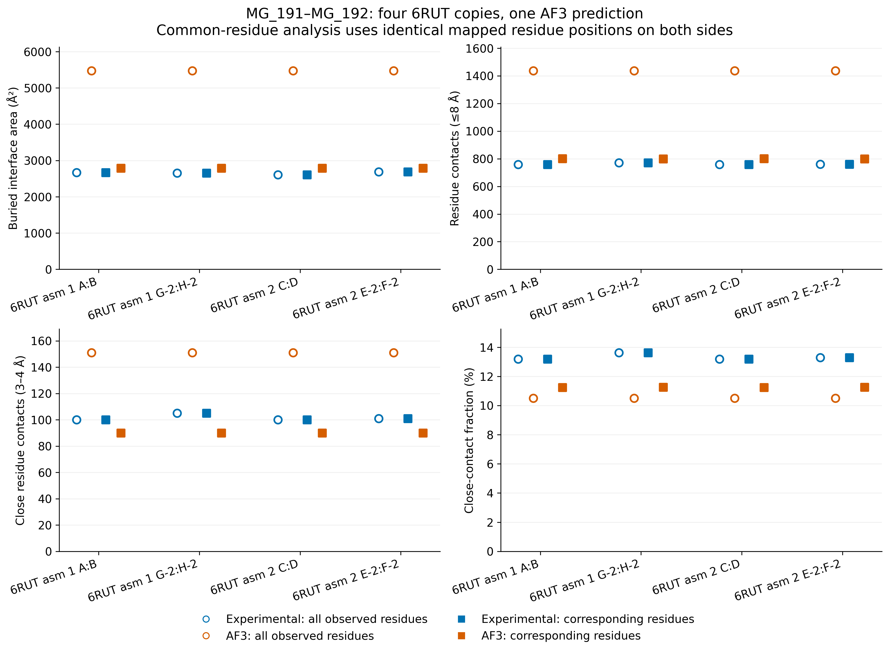
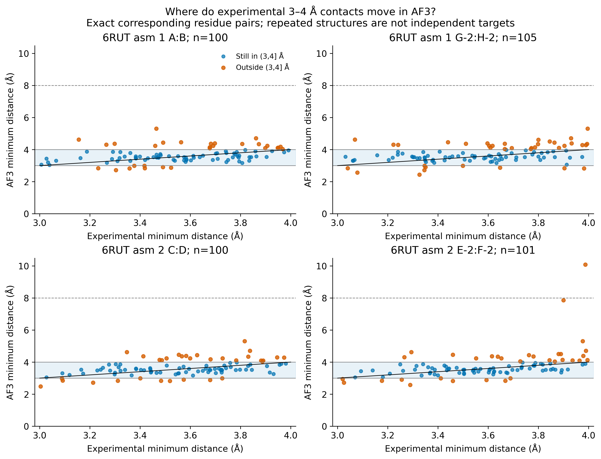
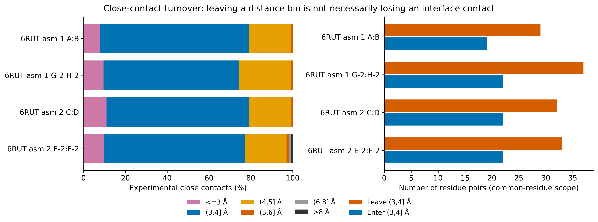
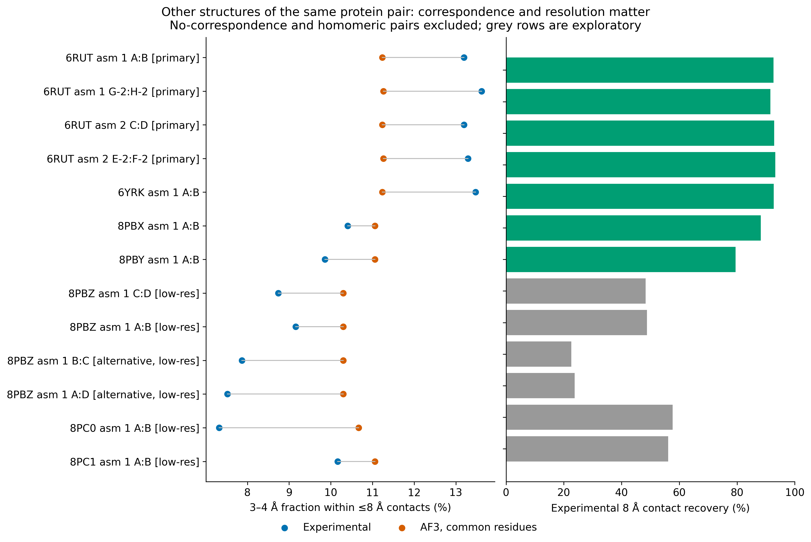
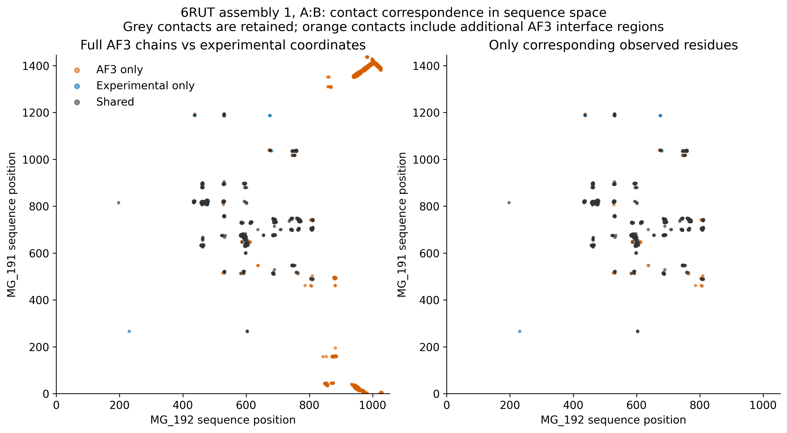

# MG_191–MG_192 figures

The five selected plots below summarize the matched single-target case; paths are relative to this directory.

## 01_6rut_full_and_common_residue_metrics

## 02_6rut_experimental_close_contact_distances

## 03_6rut_close_contact_turnover

## 04_same_target_reference_sensitivity

## 05_6rut_contact_correspondence_map

